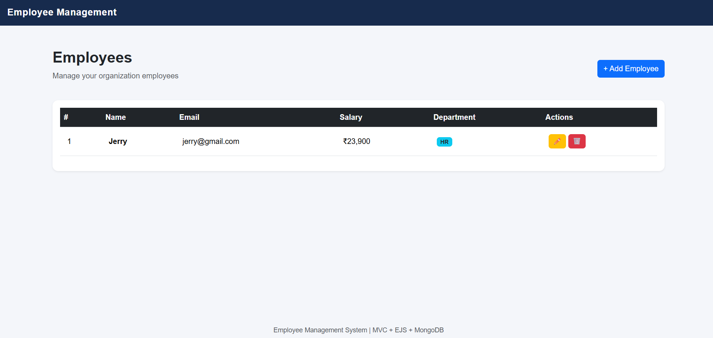

# Employee Management System

A web-based Employee Management System built using **Node.js, Express.js, MongoDB, Mongoose, EJS and MVC Architecture**.

This application allows users to manage employee records through CRUD (Create, Read, Update, Delete) operations.

## 🚀 Live Demo

The application is deployed on Render.

**[Click Here to View Live Application](https://emp-mvc.onrender.com)**

Explore the Employee Management System and experience its CRUD operations, form validation, and responsive interface.

> Note: The free Render instance may take approximately 50 seconds or more to start after a period of inactivity.

## ✨ Features

- **Add Employee:** Create new employee records.
- **View Employees:** Display all registered employees.
- **Update Employee:** Edit existing employee details.
- **Delete Employee:** Remove employee records.
- **Form Validation:** Validate employee details using Mongoose schema validation.
- **Email Validation:** Ensure valid and unique email addresses.
- **Department Management:** Assign employees to specific departments.
- **MongoDB Atlas:** Store employee records in a cloud database.
- **Responsive UI:** User-friendly interface using Bootstrap.

## 🛠️ Technologies Used

| Technology | Purpose |
|---|---|
| Node.js | JavaScript runtime environment |
| Express.js | Backend web framework |
| MongoDB Atlas | Cloud database |
| Mongoose | MongoDB object modeling |
| EJS | Server-side templating engine |
| HTML5 | Page structure |
| CSS3 | Styling |
| Bootstrap | Responsive UI |
| JavaScript | Application logic |

## 📸 Screenshots

### Employee Dashboard


### Add Employee


## 📁 Project Structure

```text
Emp_MVC/
│
├── config/
│   └── db.js
│
├── controllers/
│   └── employeeController.js
│
├── models/
│   └── Employee.js
│
├── routes/
│   └── employeeRoutes.js
│
├── views/
│   ├── partials/
│   │   ├── header.ejs
│   │   └── footer.ejs
│   │
│   └── employees/
│       ├── index.ejs
│       ├── create.ejs
│       └── edit.ejs
│
├── public/
│   └── css/
│       └── style.css
│
├── screenshots/
│   ├── dashboard.png
│   ├── add-employee.png
│   └── edit-employee.png
│
├── .env
├── .gitignore
├── app.js
├── package.json
└── README.md
```

## ⚙️ Installation and Setup

### 1. Clone the Repository

```bash
git clone https://github.com/labdemo80/Emp_MVC.git
```

### 2. Navigate to the Project Folder

```bash
cd Emp_MVC
```

If the application is inside a subfolder, navigate into that folder before running the following commands.

### 3. Install Dependencies

```bash
npm install
```

### 4. Configure Environment Variables

Create a `.env` file in the project root directory.

```env
MONGODB_URI=your_mongodb_atlas_connection_string
PORT=5000
```

Replace the MongoDB URI with your actual MongoDB Atlas connection string.

**Important:** Never upload your `.env` file or database credentials to GitHub.

### 5. Run the Application

For development:

```bash
npm run dev
```

For production:

```bash
npm start
```

Open your browser:

```text
http://localhost:5000
```

## 🌐 Application Routes

| Method | Route | Description |
|---|---|---|
| GET | `/` | Redirect to employee list |
| GET | `/employees` | Display all employees |
| GET | `/employees/create` | Display employee creation form |
| POST | `/employees/create` | Insert a new employee |
| GET | `/employees/edit/:id` | Display employee edit form |
| POST | `/employees/edit/:id` | Update employee details |
| POST | `/employees/delete/:id` | Delete an employee |

## 🗄️ Employee Schema

The Employee model includes the following fields:

| Field | Data Type | Validation |
|---|---|---|
| name | String | Required, minimum 3 characters |
| email | String | Required, unique, valid email |
| salary | Number | Required, minimum value 1 |
| department | String | IT, HR, Finance, Marketing |

## 🏗️ MVC Architecture

The project follows the Model-View-Controller (MVC) architecture.

- **Model:** Handles database structure and validation using Mongoose.
- **View:** Displays the user interface using EJS templates.
- **Controller:** Handles application logic and CRUD operations.
- **Routes:** Defines application endpoints and connects them to controllers.

## ☁️ Deployment

The application is deployed using **Render**, with MongoDB Atlas as the cloud database.

### Render Configuration

| Setting | Value |
|---|---|
| Build Command | `npm install` |
| Start Command | `npm start` |
| Environment | Node.js |
| Database | MongoDB Atlas |

Configure the `MONGODB_URI` environment variable in Render's Environment settings.

## 🎯 Learning Objectives

This project demonstrates:

1. Understanding Node.js and Express.js.
2. Implementing MVC architecture.
3. Connecting MongoDB using Mongoose.
4. Creating and validating Mongoose schemas.
5. Performing CRUD operations.
6. Handling Express routes and controllers.
7. Rendering dynamic pages using EJS.
8. Managing environment variables.
9. Deploying a Node.js application using Render.

## 👨‍💻 Author

Developed as a practical project to demonstrate full-stack web development using Node.js, Express.js and MongoDB.

---

⭐ If you find this project useful, consider giving the repository a star!
